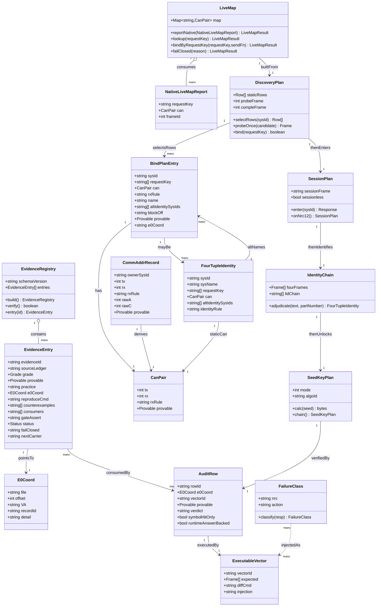
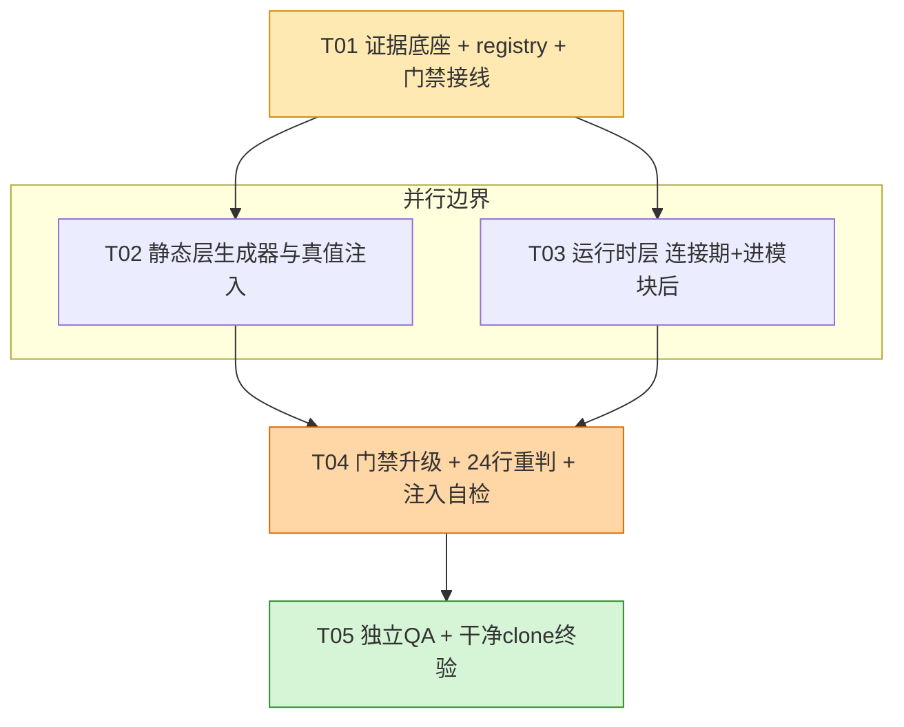

# 架构设计 + 任务分解｜全链路真实对齐 431（静态+动态双证据收口）

> **文档性质**：架构任务书（只写架构，不改 `src/` `tools/` `data/` `package.json`）。
> **基线**：HEAD `d8627c5`，工作区干净。
> **输入（逐份读完）**：
> - `docs/PRD-全链路真实对齐-20261120.md`（定稿）
> - `docs/evidence/431-static-allmodels-20261120.md`（静态真值账本，E01–E15）
> - `docs/evidence/431-linkmap-20261120.md`（连接期账本，E-01–E-20）
> - `docs/evidence/431-postentry-20261120.md`（进模块后账本，PE-01–PE-60）
> - `docs/工程规范-验收文档与发版面.md`
> **原始 431 包**：`/Users/se818/porsche-mapper/ref`（只读证据源，禁止改动其中任何字节）。
>
> **范围铁律**：本轮只做本项目与 Porsche 431 的对齐。其它诊断协议族、其它车型品牌、其它项目产物均不在范围，本文不列举、不引用、不作为对照。

---

## Part A · 系统设计

### 1. 实现方案总览

#### 1.1 核心难点

1. **证据口径切换**：现有 243 行审计（41 基线 + 202 新增，`tools/align431-rows.json`）全部靠静态 `evidence/jsonCount` 与符号命中翻 A，零运行时应答。必须升级为「E0 坐标 + 可执行向量 + diff=空」双举证。
2. **静态与运行时分界**：`cat=0x10` 的 tx/rx、rx 规则、请求键、帧模板静态可证；「请求键→CAN 最终绑定 / 哪个候选是活地址」三次负扫描 0 命中，只能由原生发现上报（R 级），拿不到即 fail-closed。禁止把自创「连接期全段扫描 0x700–0x7FF/200ms 每地址」写成 431 做法。
3. **同名多角色对象**：`0x0f4d` 同时是 SYS_DATA sysId、DRIVELINKS 目录键、直连请求键；`0x0e5f/0x0e60` 是异名同功能 sysId（`0x0e5f` 与其 CAN raw 相同但名字不同）。必须四元分列，身份按名字串+件号裁决。
4. **全代真值缺口**：`gen<0x14` 有 172 个 sysId 的本代真值 tx 未进 bind-plan 候选，且 302 对真值里 281 对 `rx≠+8`；根因是把请求键低 16 位当 CAN、rx 全局 +8。
5. **动态做法落地**：会话号按 sysId 表取、cat=0x60 四帧身份、seed/key 算法选择链、读写按记录 SID、特殊功能序列原样执行、失败分类（7F78 只续等不重发等），每条须有反编译 E0 坐标且 diff=空。

#### 1.2 分层架构

```
E0 唯一做法真值层（只读）
  静态字节：DSN.BIN / PORSCHE_SYS_DATA.BIN / PORSCHE_DRIVELINKS.BIN / JOB.BIN / MENU.BIN / GAG_COMMAND
  反编译做法：libPORSCHE_LINK.so / _SYSP.so / _FILE.so / _COMM.so / _READWRITE.so / _ENTERSYSPASSWORD.so / _SPECF.so / COMM_ABSTRACT_LAYER.so
        │  复算命令（file:offset / VA / recordId + 命令）
        ▼
机器可读证据 registry 层（E2，可再生成）
  data/align431-evidence-registry.json  ← tools/build-align431-evidence-registry.mjs
  每条：evidenceId | E0 坐标 | 命令 | 做法 | provable | 反例 | 消费行
        │  生成 / 校验
        ▼
静态数据层（E2）                     运行时层（E2）
  bind-plan / comm-addr-table         连接期：静态选行→1帧探针→请求键绑定→live map(fail-closed)
  sysdata-comm / oem-enter-frames     进模块后：会话→身份→seed/key→读/写/特殊→失败分类
  每条带 provable:static|runtime
        └──────────────┬───────────────┘
                       ▼
门禁层（E0 坐标 + 可执行向量 + diff=空）
  audit-align431(243行双举证) + verify-* 族 + 注入自检 + e2e 向量（纳入而非门外）
                       ▼
独立 QA + 干净 clone 终验（两次输出 sha256 相同）
```

#### 1.3 框架与模式选择

- **不引入新框架**：沿用 `esbuild + Capacitor + 原生 JS`（PRD §0）。本轮为增量收口，引入框架会改动运行时字节行为，违反 diff=空。
- **生成器模式**：证据 registry 与 243 行 rows 全部「由命令生成、无手工维护」（P0-7 / P2-1）；审计运行时按磁盘实况重算 verdict，不信任落盘快照。
- **策略分离**：`provable: static` 与 `provable: runtime` 分列存储；runtime 六类（请求键→CAN 绑定、trim 名、25 车型落定、逐候选探测成败、0x14/0x15/0x16 owner、编码扩展流）由原生上报获得，缺失走 fail-closed 分支。
- **fail-closed 优先**：任何无 E0 坐标的兜底/默认/常量/超时/分支不进运行时（G-2）；无证据项显式标注 + fail-closed，附下一载体与扫描命令，禁止猜值、沿用他代、静默兜底。

---

### 2. 文件清单（相对路径）

> 操作列：`新`=新增，`改`=修改，`重生`=由生成器重生成（内容由命令决定，不手改）。每个文件归属唯一 task（见 §9），便于并行派工。

#### 2.1 证据底座（T01）

| 路径 | 操作 | 职责 | 不变量 |
|---|---|---|---|
| `tools/align431-evidence-schema.json` | 新 | registry 的 JSON Schema（字段/枚举/必填） | 定义 `provable∈{static,runtime}`、`grade∈{S,R,D}`、E0 坐标必填；schema 变更须同步 builder 与 verify |
| `tools/build-align431-evidence-registry.mjs` | 新 | 从三本证据账本的证据 ID + E0 坐标生成 registry；内联复算命令 | 无时间戳/随机/绝对路径；`Object.keys().sort()`；生成的 sha256 稳定；命令仅引用只读原始包 |
| `data/align431-evidence-registry.json` | 重生 | 机器可读证据账本（E01–E15 / E-01–E-20 / PE-01–PE-60） | 每条有 E0 坐标、命令、做法、provable、反例、消费行；无坐标条目数=0 |
| `tools/verify-align431-evidence-registry.mjs` | 新 | registry 自检：schema 合规、坐标可复算、命令退出 0、无孤条目 | 缺字段/坐标非法/命令失败任一即红；退出 0 + stdout 命中断言名 |
| `package.json` | 改 | 把新增 gate 接入 `test` 链与 `audit:align431` 后段 | **不改 `scripts/sync.mjs` 的构建行为**；不改依赖版本；只增 gate 调用行 |

#### 2.2 静态层生成器与数据（T02）

| 路径 | 操作 | 职责 | 不变量 |
|---|---|---|---|
| `tools/export-bind-plan.py` | 改 | 全代真值注入：623 sysId、gen<0x14 的 172 真值入候选、rx 按 cat=0x10 表、v3key 禁当 CAN、四元对象字段 | 请求键低 16 位当 CAN 的路径数=0；硬编码 `+8` 路径数=0；每条候选带 E0 坐标；`provable` 必填 |
| `tools/build-comm-addr-table.mjs` | 改 | cat=0x10 地址表加 `provable:static`、rx 规则原样（+0x6A/+0x100/+8/rx<tx）、四元身份字段 | `rx=A>>5/C>>5` 可离线复算；`&0x7FF` 回绕=0；`+0x6A` 不做全局常量 |
| `tools/verify-align431-static-truth.mjs` | 新 | 静态层 E0 复算 diff=空：172/302/281、623/408、四元对象、Macan 双绑、Boxster/Cayman 签名全等校验 | 反例注入（错 rx/伪候选/单绑 Macan/未校验签名即合并）必红；缺 provable 标记行=0 |
| `data/bind-plan.json` | 重生 | 绑定计划（由 `export-bind-plan.py` 生成） | 与生成器输出逐字节一致；cands 含本代真值；四元字段齐全 |
| `data/comm-addr-table.json` | 重生 | 通信地址表（由 `build-comm-addr-table.mjs` 生成） | 每条 cat=0x10 记录带 `provable:static` 与 rxRule |

#### 2.3 运行时层（T03）

| 路径 | 操作 | 职责 | 不变量 |
|---|---|---|---|
| `src/live-map.js` | 新 | 原生上报 live-map 接口：请求键→已应答 CAN 的运行时映射；上报缺失 fail-closed | 不生成 CAN 地址、不做全段枚举；无原生上报时返回 fail-closed 且保留 R 级标注；每候选 1 帧 |
| `src/sweep.js` | 改 | 删除自创 `0x700–0x7FF` 全段枚举；改为按 DRIVELINKS addrBlock 静态选行 + 1 帧 `22 14 09` 探针 | `sweepPlan()` 不再逐地址扫；每候选探针帧数=1；n==0 跳过探针；rx 取表不再 `rxFor=tx+8` |
| `src/app.js` | 改 | 重写发现链：`ensureLiveMap/sweepAndMap`(L106–193) 接原生上报+fail-closed；`probeAddressFor/tryAddr`(L573–737) 每候选 1 帧、请求键绑定；`enterSystem`(L2654) 后身份裁决(L3010–3030)按四帧 | 绑定入参为请求键，低 16 位当 CAN 路径=0；探针阶段不发身份帧；`finish()` 只在 L3000 注释所述阶段 |
| `src/probe.js` | 改 | `probeList/familyCandidates`(L137–208) 按静态选行；`identityPhaseFrames/identityAdjudicate`(L47, L316) 按 cat=0x60 四帧 + 名字串/件号裁决 | 身份不按单一 sysId 数值、`raw` 相同不合并；NRC 不当识别串；1A 链 3 miss 截断 |
| `src/coder.js` | 改 | 会话(`enterSessionFor`)、seed/key、读(`readByRecord`)、写(`applyChange`)、特殊功能(`runRoutine`)、失败分类按 E0 做法 | 会话号按 sysId 表；`27` 不重试；读 SID 按记录；写不自动回滚；7F78 只续等；回帧 ID 校验 |

#### 2.4 门禁升级与注入自检（T04）

| 路径 | 操作 | 职责 | 不变量 |
|---|---|---|---|
| `tools/align431-eval.mjs` | 改 | 求值内核新增 check kind：`e0CoordVector`（E0 坐标复算）、`runtimeProbeVector`（运行时应答向量）、`provableTag`；`evaluateRow` 判 A 必须双举证 | 既有断言只收紧不删除；duplicate `case` 归类互斥；gate 真执行（退出码+断言名命中） |
| `tools/build-align431-rows.mjs` | 改 | 生成 243 行 rows：每行带 E0 坐标 + 可执行向量 ID + provable；24 行不再靠符号命中 | 机读生成非手填；基线 41 行原编号保留、删行=0、合并行=0；数字单一来源 |
| `tools/align431-rows.json` | 重生 | 243 行 rows（由 builder 生成） | 靠符号命中翻 A 行=0；零运行时应答仍标 A 行=0 |
| `tools/audit-align431.mjs` | 改 | 审计输出增列：E0 坐标、可执行向量、diff 结果、24 行重判标记、注入自检汇总 | 退出码三态保持；sha256 只含机器无关事实；末尾 `clearGateCache()` |
| `tools/verify-align431-injection.mjs` | 新 | 反例注入套件：错 sysId/错 rx/伪候选/`planSysId=null` 静默/全 NO DATA 标 A/E1 泛化/请求键当 CAN/runtime 静态写死/单绑 Macan | 每类注入能红率=100%；假绿=0；注入后恢复磁盘原状 |
| `e2e-flow.mjs` | 改 | 把真车/合成向量输出为门禁可读的可执行向量文件，纳入 `audit:align431` | e2e 向量在门禁内而非门外；E1 只抽样不泛化；两次输出一致 |

#### 2.5 独立 QA 与终验（T05）

| 路径 | 操作 | 职责 | 不变量 |
|---|---|---|---|
| `tools/verify-align431-qa.mjs` | 新 | 独立重算 A-1..A-10：坐标覆盖、diff=空、注入能红率、provable 标记、四元对象字段、数字单一来源 | 只读不改产物；与被测 gate 无共享断言实现；任一判据不满足即红 |
| `docs/ACCEPTANCE-ALIGN431-20261120.md` | 新 | 命令输出证明的验收记录（非文档自宣） | 每条结论附复跑命令+退出码+sha256；不含「文档自宣全 A」式结论 |
| `docs/工程规范-验收文档与发版面.md` | 改 | 把新增在册文档与 gate 纳入「必须入库 / 落地自检清单」 | 扫描集下限不下降；在册文档 `git ls-files` 成功；门禁断言不放宽 |

> **不改文件声明**：`scripts/sync.mjs` 的构建行为、`package.json` 的依赖版本、原始 431 包、发版面清洗策略均不在改动范围。

---

### 3. 数据结构与接口

#### 3.1 evidence registry schema（`data/align431-evidence-registry.json`）

每条证据条目字段：

| 字段 | 类型 | 说明 |
|---|---|---|
| `evidenceId` | string | 三本账本证据 ID：`E01..E15` / `E-01..E-20` / `PE-01..PE-60` |
| `sourceLedger` | string | 来源账本文件名（相对路径） |
| `grade` | enum | `S`（静态字节可独立复算）/ `R`（运行时事实，机制 S 真值 R）/ `D`（我方设计，禁称 431 做法） |
| `provable` | enum | `static` / `runtime`，与 G-5/A-10 对齐 |
| `practice` | string | 431 做法陈述（一句话，动词开头） |
| `e0Coord` | object | `{file, offset? | VA? | recordId?, detail}`；至少一种坐标非空 |
| `reproduceCmd` | string | 可复算命令（只读原始包，无绝对路径输出） |
| `counterexamples` | string[] | 反例做法 ID（对应账本「反例」列 / G 表） |
| `consumers` | string[] | 消费该证据的实现行 ID（`rowId` 或 `src:line`） |
| `gateAssert` | string | 对应 gate 断言名（可机读 grep） |
| `status` | enum | `verified` / `unresolved`（unresolved 必须带 `failClosed` 与 `nextCarrier`） |
| `failClosed` | string? | 无证据/上报缺失时的显式失败行为 |
| `nextCarrier` | string? | 下一取证载体 + 扫描命令 |

#### 3.2 bind-plan / comm-addr-table 输出字段

| 字段 | 类型 | 说明 |
|---|---|---|
| `sysId` | string | `0x` 前缀十六进制；来自 SYS_DATA name-9 / DSN low+type，高字节仅取规范 type |
| `requestKey` | string[] | 请求键空间 `0x0030xxxx`/`0xFF60xxxx`（DRIVELINKS bindKey），**不是 CAN**；绑定入参 |
| `can` | object | `{tx, rx, rxRule, provable:'static'}`；仅 cat=0x10 直接给出或 C 字段派生；无记录不得静态写死 |
| `rxRule` | string | `rx=tx+0x6A` / `+0x100` / `+8` / `rx<tx` 原样；禁 `&0x7FF` 回绕 |
| `name` | string | 模块名（如 `SWA2_BaseSys` / `BCM_hinten_BaseSys`），身份裁决依据之一 |
| `altIdentitySysIds` | string[] | 异名同功能 sysId（如 `['0x0e5f','0x0e60']`）；**禁止称「身份 sysId」** |
| `blockOff` | string | DRIVELINKS blockOff；相同→可只取首枚，不同→必须分别绑定 |
| `provable` | enum | `static` / `runtime` |
| `e0Coord` | string | 回指 E0 坐标 |

**0x0f4d 四元对象实例（`provable:static`）**：

```json
{
  "sysId": "0x0f4d",
  "sysName": "SWA2_BaseSys",
  "requestKey": [0x06CC, 0x06CF],
  "can": { "tx": 0x74E, "rx": 0x7B8, "rxRule": "rx=tx+0x6A", "provable": "static" },
  "altIdentitySysIds": ["0x0e5f", "0x0e60"],
  "identityRule": "nameVariant + PARTNUMBER memcmp",
  "provable": "static"
}
```

#### 3.3 runtime live-map 接口（`src/live-map.js`）

```
interface NativeLiveMapReport {
  // 原生发现循环上报（R 级机制，showAddress("4000")）；Java/JS 层不生成地址
  requestKey: string;        // 请求键 0x0030xxxx / 0xFF60xxxx
  can: { tx: number, rx: number };
  frameId: number;           // 回帧 CAN ID，用于防串线
}

interface LiveMapResult {
  ok: boolean;
  state: 'bound' | 'fail-closed' | 'unavailable';
  map?: Map<requestKey, {tx, rx, frameId}>;
  reason?: string;           // fail-closed 原因 + 下一载体 + 扫描命令
  provable: 'runtime';
}

// 核心方法（失败分支必须存在，注入为红）
reportNative(report: NativeLiveMapReport): LiveMapResult   // 收到上报→绑定
lookup(requestKey: string): LiveMapResult                  // 未绑定/上报缺失→fail-closed
bindByRequestKey(requestKey, sendFn): LiveMapResult       // 入参为请求键，1 帧探针，uxth==1 才绑
```

#### 3.4 类图（Mermaid `classDiagram`）



---

### 4. 程序调用流程与时序图

#### 4.1 关键步骤 → 证据 ID → gate 映射

| 步骤 | 431 做法 | E0 证据 ID | gate |
|---|---|---|---|
| 连接期静态选行 | DRIVELINKS addrBlock 原样搬移，无 internal→CAN 换算 | E-02 / PE-01 | `verify-align431-static-truth` |
| 每候选 1 帧探针 | `22 14 09`(0xFF001409)，r2=1，n==0 跳过 | E-01 / PE-01 / PE-02 | `verify-oem-probe-diff` |
| 请求键绑定 | `send(0x10000359, A, 2)`，uxth==1 绑定；补帧 `22 11 02` | E-01 / E-06 / PE-02 | `verify-live-map-failclosed` |
| live map | 原生上报请求键→CAN；缺失 fail-closed | E-05 / E-20 | `verify-live-map-failclosed` |
| 会话 | 10 03×706/89×210/85×2/86×5；KWP 68 sessionless；7F10 12 换号 | PE-10/11/12 | `verify-oem-session` |
| 四帧身份 | `3E00→22F19E→22F1A2→1003`，185/185；1A 链 3 miss 截断 | PE-20/21/22 | `verify-oem-probe-diff` |
| seed/key | `27 09 01 00`→`67 09 seed`→`27 0A key`；算法分发链 | PE-30/31/32 | `sa2-coverage-audit` |
| 读 | `21<LID8>/22<DID16be>/1A`；正响应 +0x40 | PE-40/42 | `verify-fullchain` |
| 写 | `3B/2E`；备份→SA→写→回读，不回滚 | PE-41/43 | `verify-write-gate` |
| 特殊功能 | SPECF 687 功能原样执行；31 01→31 03 轮询；空参裸 31 拦截 | PE-45/46 | `verify-drive-disabled-gate` |
| 失败分类 | 7F78 续等不重发；0x12/35/36 不重试；NO DATA=失败 | PE-50~55 | `verify-keepalive-78` |
| 超时 | 5000/8000/16000；IDENTIFY=8000，LINK_DEFAULT=5000 | E-04 / PE-14 | `verify-comm-timeouts` |

#### 4.2 时序图（Mermaid `sequenceDiagram`）

```mermaid
sequenceDiagram
    autonumber
    actor U as 上层调用
    participant LM as src/live-map.js
    participant AP as src/app.js(发现链)
    participant PB as src/probe.js
    participant CD as src/coder.js
    participant G as 门禁verify-*
    participant E0 as E0证据(只读原始包)

    Note over E0,LM: 【连接期】静态选行 + 1帧探针 + 请求键绑定 (E-02/E-01/PE-01)
    U->>AP: connect(vin, sysId)
    AP->>E0: 复算 addrBlock 静态选行 (E-02)
    E0-->>AP: staticRows (rx取cat=0x10,非+8)
    loop 每个候选(每候选仅1帧)
        AP->>CD: send(requestKey, 22 14 09) (PE-02)
        CD-->>AP: resp (uxth==1?)
    end
    Note over AP: n==0 跳过探针直绑 (PE-01)
    alt 原生上报可用
        E0-->>LM: showAddress("4000"): requestKey→CAN (R级,E-05)
        LM->>LM: reportNative() 绑定, frameId防串线
        LM-->>AP: LiveMapResult(ok,bound,runtime)
    else 上报缺失/无绑定
        LM-->>AP: LiveMapResult(fail-closed,reason+nextCarrier) (E-20)
        Note right of LM: 禁止全段枚举/静态写死CAN/标A
    end
    AP->>G: verify-live-map-failclosed (注入上报缺失必红)
    G-->>AP: gate PASS/FAIL

    Note over CD: 【进模块后】会话 (PE-10/11/12)
    U->>CD: enterSessionFor(sysId)
    CD->>E0: 查 OEM_SESSION_BY_SYSID (PE-10)
    alt sessionless(68 sysId)
        CD-->>U: 不发10xx (PE-12)
    else 10xx
        CD->>CD: 发会话帧, 校验50+回显
        alt 7F 10 12
            CD->>CD: 换模板号, 不重试同号 (PE-11)
        end
    end

    Note over PB: 四帧身份 (PE-20/21) + 名字串/件号裁决
    CD->>PB: identityAdjudicate(四帧, 1A链)
    PB->>E0: cat=0x60 四帧模板 (PE-20)
    PB->>PB: 名字串 SWA2 vs BV_* + PARTNUMBER (E-11)
    Note right of PB: 不按sysId数值单一裁决; raw相同不合并
    PB-->>CD: FourTupleIdentity(0x0f4d四元)

    Note over CD: seed/key (PE-30/31/32)
    CD->>E0: mode表→家族→名字分发 (PE-31)
    alt 有算法(962/135变体)
        CD->>CD: 27 09 01 00→key→27 0A (不重试)
    else 无case 104 或 mode0x1D 4条
        CD->>CD: outLen=0不发key继续写 / 名字分发或fail-closed (PE-32)
    end

    Note over CD: 读/写/特殊/失败分类 (PE-40..55)
    CD->>CD: 读SID按记录(+0x40), 写3B/2E备份→回读
    CD->>CD: 特殊功能序列原样, 空参裸31拦截 (PE-45/46)
    alt 7F xx 78
        CD->>CD: 续等不重发 (PE-50)
    else 0x12/0x35/0x36/NO DATA
        CD->>CD: 单发即败上浮, 不重试/不换SID (PE-51..54)
    end
    CD->>CD: 回帧ID校验, 错ID当场报错 (PE-55)
    CD->>G: 全链 gate + 243行审计 (diff=空)
    G-->>U: A-1..A-10 结果(命令输出证明)
```

---

### 5. 门禁改造计划

#### 5.1 243 行从「静态 evidence/jsonCount」升级为「E0 坐标 + 可执行向量 + diff=空」

- **现状**：`tools/align431-rows.json`（41 基线 + 202 新增 = 243）每行靠 `check.kind ∈ {evidence, jsonCountEq, jsonCountGte, includes, ...}` 判定；`evaluateRow` 要求 `forensicGrade==='A'` 且 gate 真执行；但证据多为 `data/*` token 命中，零运行时应答。
- **目标**（T04）：
  1. 新增 check kind：`e0CoordVector`（复算 E0 坐标期望值，与实发 diff=空）、`runtimeProbeVector`（加载 e2e 纳管的可执行应答向量）、`provableTag`（校验输出行带 provable 且 runtime 未被静态写死）。
  2. 每行增字段 `e0Coord` / `vectorId` / `provable` / `runtimeAnswerBacked` / `symbolHitOnly`；判 A 必须 `e0Coord` 合法 + diff=空 +（static 行 E0 复算通过 或 runtime 行有应答向量/原生上报证据）。
  3. `build-align431-rows.mjs` 机读生成，基线 41 行原编号保留、删行=0、合并行=0；数字单一来源（623/408/172/302/281/…）来源命令由 registry 提供。
  4. 审计输出增列 + 24 行重判标记 + 注入自检汇总；退出码三态保持（0 全 A / 2 仅前置未构建 / 1 其余），sha256 只含机器无关事实。

#### 5.2 24 行 B/D→A 必须重判

实测 `align431-rows.json` 中 `originalVerdict ∈ {B,C,D}` 共 **24 行**（B 14 / C 5 / D 5），全部已翻 A。清单（按 `rowId`）：

```
GAP-INVENTORY-20261112.md:42(B)  :43(B)  :45(B)  :46(D)  :48(B)  :51(B)
:52(C)  :56(B)  :57(B)  :58(B)  :59(C)  :62(B)  :63(D)  :66(B)  :67(B)
:70(B)  :71(B)  :73(B)  :74(D)  :75(C)  :78(C)  :79(C)  :80(D)  :81(D)
```

重判规则：逐行替换为 E0 坐标 + 可执行向量；若该行只有符号命中而无 E0 复算/运行时应答，则回退为非 A（或标 `unresolved` + fail-closed），不得保留 A。验收判据：`靠符号命中翻 A 行数 = 0`。

#### 5.3 e2e 向量纳入门禁

- `e2e-flow.mjs` 在跑真车/合成向量时，把每步期望帧序写成 `tools/align431-vectors/*.json`（`vectorId` / `expected` / `diffCmd` / `injection`）。
- `audit-align431.mjs` 新增段读取向量文件并逐条 diff；e2e 不再是门禁外资产。
- E1（本机单车日志）只作抽样：向量集里 E1 来源条目标 `grade:R, provable:runtime, sampleOnly:true`，禁止泛化为全代真值。

#### 5.4 注入自检清单（`tools/verify-align431-injection.mjs`）

| # | 注入 | 期望转红的断言 |
|---|---|---|
| 1 | 改错 sysId（如把 `0x0e23` 写成 DME） | `verify-align431-static-truth` 身份坐标断言 |
| 2 | 改错 rx（把 `+0x6A` 改成 `+8`） | `verify-oem-probe-diff` + 静态真值 rxRule 断言 |
| 3 | 注入伪候选（请求键低 16 位当 CAN） | `bind-plan` E0 复算 + `e0CoordVector` |
| 4 | `planSysId=null` 静默兜底 | fail-closed 分支断言 |
| 5 | 全 NO DATA 标 A | `runtimeAnswerBacked` 断言 |
| 6 | E1 日志泛化全代 | `provable` + `sampleOnly` 断言 |
| 7 | runtime 静态写死 CAN | `provableTag` 断言 |
| 8 | Macan 只绑 `0x0f23` 漏 `0x0f34` | 四元/双绑断言（按 `blockOff` 不同） |
| 9 | 删/改名任一 gate 断言 | `NO_ASSERTION_DELETED` 完整性检查 |
| 10 | 上报缺失仍标 bound | `verify-live-map-failclosed` 分支断言 |

自检后恢复磁盘原状；每类注入能红率=100%、假绿=0。

---

### 6. 关键数字与对象口径

#### 6.1 数字单一来源

| 数字 | 含义 | 来源命令/坐标 |
|---|---|---|
| **623** | bind-plan ecu 全部 sysId | `len(json.load(open('data/bind-plan.json'))['ecu'])` |
| **408** | 有 cat=0x10 本代真值的 sysId（gen<0x14 的 296 + gen≥0x14 的 112） | `comm-addr-table` byGeneration 聚合 |
| **296** | gen<0x14 有本代真值的 sysId 数（注意与已废止的「大小写未归一假多算 296」区分：后者是缺值虚增，正确缺值为 172） | 静态账本 §7 归一命令 |
| **172** | 归一后 gen<0x14 真值 tx 未进 bind-plan cands 的 sysId 数（P0-1 判据 172→0） | `norm=str.lower().replace('0x','')` 交叉比对命令 |
| **302** | gen<0x14 本 sysId 真值配对数 | 同上命令 pairs |
| **281** | 302 对中 `rx≠+8` 的配对数 | 同上命令 `rxRule!='rx=tx+8'` |
| **2566** | 见 §7 UNCLEAR：三本账本未定义，T01 须补 E0 复算命令，否则从单一来源清单移除，禁止猜值 | 待定 |
| **486 / 243 / 24** | 零覆盖 sysId 现状 / 审计行数 / B/C/D→A 行数 | `audit-align431` 输出 + `align431-rows.json` |

> **禁止混写**：`307`（全表任意 tx 同值冲突口径）≠ `281`（本 sysId 真值配对 rx≠+8 口径）；旧 296（归一 bug）已废止。

#### 6.2 对象口径（实现与门禁必须一致）

- **`0x0e23` = BCM_hinten（后端电子设备，gen 0x0E），不是 DME**。`cat=0x10` @ `SYS_DATA:0x1191B`，raw `0xE1A0/0xEEE0` → **tx=0x70D / rx=0x777 / rx=tx+0x6A**（本轮已实算复核）。请求键 `blockKey=0x236d`、internal `0x04ff/0x06a7…`、`bindKey=0x003004FF…`；真值 `0x70D` 未进旧候选（旧候选 v3key 低 16 位）。
- **`0x0b23` = BCM_hinten（gen 0x0B），不是 DME**；与 `0x0e23` 同 raw `0xE1A0EEE0`→`0x70D/0x777`。**DME 身份 sysId 全集 = `0x0b01 / 0x0c01 / 0x0e01 / 0x0f01`**，均 raw `0xFC00FD00`→`0x7E0/0x7E8`（+8）。四者不可把 `0x0b23` 归入。
- **`0x0f4d` 四元对象**（见 §3.2）：`sysId='0x0f4d'`（SWA2_BaseSys，gen 0x0F，合法 SYS_DATA sysId + DRIVELINKS 目录键 + 直连请求键三合一）；`requestKey=[0x06CC,0x06CF]`（即 `0x003006CC–CF`）；`can={tx:0x74E,rx:0x7B8,rxRule:'rx=tx+0x6A'}`（@`SYS_DATA:0x35EBC`，A=`0xE9C0>>5`、C=`0xF700>>5`）；`altIdentitySysIds=['0x0e5f','0x0e60']`（`BV_ContrUnitLaneChangAssis2UDS_BaseSys`，gen 0x0E；`0x0e5f` raw 同 `0xE9C0F700` 但名字不同，`0x0e60`→`0x4D2/0x232`）。
  - 进模块查 live map 用 sysId `0x0f4d` + 请求键 `0x06CC–CF`；身份裁决靠名字串 `SWA2_BaseSys` vs `BV_*` + 件号（JOB.BIN memcmp）。
  - 字段名必须 `altIdentitySysIds`/`nameVariantSysIds`；**禁止称「0x0f4d 的身份 sysId」**、禁止按单一 sysId 数值裁决、禁止 raw 相同即合并、禁止写「0x0f4d 不是 sysId」。
- **Macan 多模块分别绑定**：「后端电子设备」= `0x0f23`(BCM_hinten) + `0x0f34`(Heckklappe)，DRIVELINKS blockOff 不同 → 必须分别绑定，只取一枚即红；与「同 blockOff 双 sysId 可只取首枚」（如 `0x0e59/0x0e5a` 后桥转向）按 blockOff 是否相同区分。
- **seed/key 104+4 口径**：1070 条 = 可算 962 / 不需 key 104 / 拒写 4（需要 key 可算率 962/966）；135 变体入库 675/675 自检通过。**104 条 = 431 明确无 case → outLen=0 → 不发 key 继续写入**（非拒写、非缺口）；**4 条 mode 0x1D**（`0x0f12/0x0f32/0x0f54` 等）依赖会话全局态 `TOKEN+0x408838` → 名字分发兜底（EPS 可算）或 fail-closed，**不猜 key**（猜错→35→36 锁死）。「61.4% 无真值」是覆盖率统计口径，非缺陷。
- **cat=0x60 四帧**：`3E 00 → 22 F1 9E → 22 F1 A2 → 10 03`，**185/185 block 逐字节全同**（distinct=1；74 sysId 共享 21 索引值）。禁止把 4 帧掺进探针阶段，禁止把 `1A9B` 当 UDS 身份帧。
- **失败分类**：`7F78` = 已受理待处理 → **续等不重发**（`Set7F78Ctrl`@`COMM_ABSTRACT:0x39510`；续等期间不周期发 3E）；`0x12` 子功能拒 / `0x11`/`0x10`/`0x22`/`0x31` → 单发即败上浮、不重试不换 SID；`0x35`/`0x36` 钥匙错/超次 → 不重试防锁死；`NO DATA` = 失败/候选死，**不等于没装**。
- **会话**：`10 03×706 / 10 89×210 / 10 85×2 / 10 86×5`，`10 02` 命中 0；68 老代 KWP sysId sessionless 不发 10xx；`7F 10 12` 换模板号不重试。
- **超时**：唯一可证 `iCommunicationMaximumWaitTime` = 5000/8000/16000 ms（`COMM_ABSTRACT:0xC2024` file / `0xC3024` VA = 5000）；IDENTIFY=8000、LINK_DEFAULT=5000。2500ms 保活周期等是我方设计，不冒称原厂。

---

### 7. Anything UNCLEAR（风险与待明确）

> 只列 E0 标注为 R / 未证 / 本轮资料未定义的项。每项给 fail-closed 设计与验证点；不以「需要实车确认」作为结案词。

| # | 未明确项 | 级别 | fail-closed 设计 | 验证点 / 下一载体 |
|---|---|---|---|---|
| U1 | **数字 `2566` 的定义**：PRD P1-2 列入单一来源清单，但三本证据账本未给出坐标或复算命令（`drivelinks-v3.json` 中出现该字面量，语义未证） | 未定义 | T01 不得猜值；若无法给出 E0 复算命令，则**从单一来源清单移除**并在 PRD 标注，禁止沿用或自创 | 在 `PORSCHE_DRIVELINKS.BIN` / `.so` 反编译中定位该计数语义，附坐标+命令后再入清单 |
| U2 | **请求键→CAN 最终绑定 / 哪个候选是活地址** | R（机制 S、真值 R） | 只由原生发现上报获得；上报缺失→`LiveMapResult(fail-closed)` + R 级标注，不静态写死、不标 A | 原生 `showAddress("4000")` 上报接口字段/时序；msm 全树+`libPORSCHE_LINK.so` 反编译 |
| U3 | **trim 显示名（Boxster/Cayman 精确款）、25 车型精确落定** | R | VIN 只定平台；精确款靠 `22 11 02`/`22 14 0A` 识别串；拿不到则记 runtime 缺失，不静态填 | GAG 文本库 + 车上识别串；`vin-vehicle-map.json` 仅 15 分支到平台 |
| U4 | **0x14/0x15/0x16 路由 owner** | 弱证据 | 静态候选靠跨代表 A∩路由；无 owner 走 live-map 兜底，兜底缺失 fail-closed | `sysdata-routing.json:byOwner` 三键各 0 条；下一载体扫描命令 |
| U5 | **编码地址扩展流** | 未证 | 981 及全库统一走 ALLDATA coding 池；扩展流静态不猜 | 3958 条 name 记录 640 unknown；IdSearch ctx+0x638 连接期产物 |
| U6 | **保活周期毫秒数** | 无包证据 | 我方 2500ms 显式标 `OUR_DESIGN`，不写原厂值；78 续等不发周期 3E | `PorscheSetLinkKeep`@`COMM:0x12324` 内 `#0x1E` 语义/单位 |
| U7 | **mode 0x1D 的 `TOKEN+0x408838` 会话全局态（4 条）** | 无包证据 | 名字分发兜底（EPS 可算）或 fail-closed 不猜 key；绝不拒写全部、绝不试 key | `Xml_GetDriveLinksAddress@0x18a0c` + `PORSCHESecurityModel.c` case 0x1d |
| U8 | **写序言 A/B/C 完整分派表；21 04 xxxx 多字节 LID 参数语义；10 00→10 89 复合模板触发场景；GagLookup 加密键映射** | 无包证据 | 形态已证、分派表未提取全者按已知形态执行，分派未知项 fail-closed 标注 | `RE-FLOWSPEC`/`RE-WRITEGATES` 逐项下一载体与扫描命令 |

---

## Part B · 任务分解

### 8. 依赖包（Required Packages）

沿用现有栈，**不新增第三方依赖**（PRD §0 / 避免改运行时字节行为）。实现期使用仓库内既有工具：

```
- node (ESM) + assert/strict        : 门禁与求值内核（Node 内置）
- python3 (系统默认)               : 静态 BIN 解析生成器（export-bind-plan.py 等）
- /Users/se818/.workbuddy/binaries/python/envs/default/bin/python3 + capstone 5.0
                                    : tools/disasm-elf.py 反编译复核（只读）
- esbuild@^0.25.0                   : 构建（devDep，不改行为）
- @capacitor/* + playwright         : 原生壳与 e2e（现有依赖，不升级）
```

> 无 `npm install` 需求；若实现期确需新增包，须由主理人裁定并经干净 clone 验证（不在本任务书授权内）。

---

### 9. 有序任务列表（5 个，按依赖排序）

> **文件归属互斥**：每个文件仅属一个 task，可并行派工。`前置` 列为空者可与其它无依赖 task 并行。

#### T01 · 证据底座与机器可读 registry（基础设施）

- **目标**：把三本证据账本转成机器可读 registry，定义 schema，建立自检，并把新增 gate 接入 `test` 链（不改构建行为）。**这是关键路径第一步**——registry 未落地则 A-3/A-4 无法判定。
- **独占文件**：`tools/align431-evidence-schema.json`（新）、`tools/build-align431-evidence-registry.mjs`（新）、`data/align431-evidence-registry.json`（重生）、`tools/verify-align431-evidence-registry.mjs`（新）、`package.json`（改，仅增 gate 行）。
- **实现规格**：
  - schema 定义 §3.1 全字段；`provable∈{static,runtime}`、`grade∈{S,R,D}`、`status∈{verified,unresolved}`；`unresolved` 必带 `failClosed`+`nextCarrier`。
  - builder 解析 `E01..E15`/`E-01..E-20`/`PE-01..PE-60`，每条挂 E0 坐标（`file:offset|VA|recordId`）+ 复算命令 + 反例 + `gateAssert`；确定性纪律（无 Date/random/绝对路径，`sort()`）。
  - **落实 UNCLEAR U1**：给 `2566` 补 E0 复算命令；给不出则移出单一来源清单并在输出标注 `unresolved`，禁止填值。
  - `package.json` 在 `test` 链与 `align431:rows` 后追加新 gate；**不动 `scripts/sync.mjs`、不动依赖版本**。
- **验收命令**：
  ```
  node tools/build-align431-evidence-registry.mjs
  node tools/verify-align431-evidence-registry.mjs
  node -e "import('./tools/align431-eval.mjs').then(m=>console.log(m.scanForbiddenWords().asClosingReason))"   # 0
  git diff --exit-code -- scripts/sync.mjs                                                                       # 空
  ```
- **可证伪注入**：删一条 E0 坐标 / 把 `provable` 改成非法值 / 让一条复算命令退出非 0 → `verify` 必红。
- **前置**：无（可立即开工）。

#### T02 · 静态层生成器与全代真值注入

- **目标**：静态层 E0 复算 diff=空；172→0、281 按真值、四元对象、Macan 双绑、Boxster/Cayman 合并校验；输出带 provable。
- **独占文件**：`tools/export-bind-plan.py`（改）、`tools/build-comm-addr-table.mjs`（改）、`tools/verify-align431-static-truth.mjs`（新）、`data/bind-plan.json`（重生）、`data/comm-addr-table.json`（重生）。
- **实现规格**：
  - `export-bind-plan.py`：按 `SYS_DATA cat=0x10` 的 `A>>5/C>>5` 注入 gen<0x14 的 172 真值入 cands；rx 优先取记录 C，无记录才 `tx<=0x7F7→+8`；删除 v3key/internal 低 16 位当 CAN 的路径；四元对象字段齐全（`sysId/requestKey/can/altIdentitySysIds`）。
  - `build-comm-addr-table.mjs`：每条 cat=0x10 记录加 `provable:static`、`rxRule` 原样保留（`+0x6A/+0x100/+8/rx<tx`），禁 `&0x7FF` 回绕、`+0x6A` 不做全局常量。
  - `verify-align431-static-truth.mjs`：复算 623/408/172→0/302/281；`0x0e23→0x70D/0x777`；`0x0f4d` 四元齐全 + can.provable=static；Macan `0x0f23/0x0f34` 双绑（按 blockOff 不同）；Boxster/Cayman 仅「文件集+items 签名全等」才允许合并；缺 provable 行=0。
- **验收命令**：
  ```
  python3 tools/export-bind-plan.py && node tools/build-comm-addr-table.mjs
  node tools/verify-align431-static-truth.mjs
  python3 -c "...§7归一命令..."   # 缺真值候选=0, 配对=302, rx!=+8=281
  ```
- **可证伪注入**：错 rx、伪候选、单绑 Macan、未校验签名即合并、漏四元字段 → 对应断言必红。
- **前置**：T01（registry 提供坐标与 provable 语义）。

#### T03 · 运行时层（连接期 + 进模块后按 E0 落地）

- **目标**：运行时做法逐帧/逐分支 diff=空；删除自创全段枚举；live map 原生上报 + fail-closed；动态层按 PE 账本。
- **独占文件**：`src/live-map.js`（新）、`src/sweep.js`（改）、`src/app.js`（改）、`src/probe.js`（改）、`src/coder.js`（改）。
- **实现规格**：
  - **live-map.js**：实现 §3.3 接口；`reportNative/lookup/bindByRequestKey/failClosed`；无原生上报→fail-closed（带 reason+nextCarrier+R 级标注）；每候选 1 帧 `22 14 09`，绑定入参为请求键，uxth==1 才绑；不做全段枚举、不静态写 CAN。
  - **sweep.js**：移除 `sweepPlan()` 的 `0x700–0x7FF` 逐地址扫描与 `rxFor=tx+8`；改为按 DRIVELINKS addrBlock 静态选行（rx 取表）；保留 `moduleFromIdent/buildModuleMap` 但身份按名字串+件号。
  - **app.js**：`ensureLiveMap/sweepAndMap`(L106–193) 接原生上报+fail-closed；`probeAddressFor/tryAddr`(L573–737) 每候选 1 帧、请求键绑定；删 `finish()` 阶段错位的多发帧；`enterSystem`(L2654) 后按四帧身份裁决(L3010–3030)。
  - **probe.js**：`identityPhaseFrames/identityAdjudicate`(L47/L316) 用 cat=0x60 四帧 + 名字串/件号；1A 链固定顺序、3 miss 截断；NRC 不当识别串；`raw` 相同不合并（0x0f4d vs 0x0e5f）。
  - **coder.js**：会话按 sysId 表（sessionless 不发 10xx、7F10 12 换号）；seed/key 分发链（104 不发 key 继续写、4 mode0x1D 名字分发或 fail-closed、27 不重试）；读 SID 按记录+0x40、写 3B/2E 备份→回读不回滚；特殊序列原样 + 空参裸 31 拦截；7F78 续等不重发；回帧 ID 校验。
- **验收命令**：
  ```
  node tools/verify-live-map-failclosed.mjs          # T01 gate 已接线
  node tools/verify-oem-probe-diff.mjs
  node tools/verify-oem-session.mjs && node tools/verify-keepalive-78.mjs
  node tools/verify-comm-timeouts.mjs && node tools/verify-write-gate.mjs
  node tools/verify-drive-disabled-gate.mjs
  ```
- **可证伪注入**：上报缺失仍 bound、探针改 9 帧、绑定入参改 CAN、身份掺 1A9B、7F78 重发、会话改按族发 10 89 → 对应 gate 必红。
- **前置**：T01（可并行于 T02；运行时按 registry 冻结的接口字段编码，集成时读 T02 重生的数据）。

#### T04 · 门禁升级、24 行重判与注入自检

- **目标**：243 行双举证；24 行符号命中翻 A 清零；e2e 向量纳入门禁；注入能红率 100%。
- **独占文件**：`tools/align431-eval.mjs`（改）、`tools/build-align431-rows.mjs`（改）、`tools/align431-rows.json`（重生）、`tools/audit-align431.mjs`（改）、`tools/verify-align431-injection.mjs`（新）、`e2e-flow.mjs`（改）。
- **实现规格**：
  - **eval**：新增 `e0CoordVector`/`runtimeProbeVector`/`provableTag` check kind；`evaluateRow` 判 A 需 E0 坐标合法 + diff=空 + 运行时举证；既有断言只收紧不删除（含 `NO_ASSERTION_DELETED` 完整性）。
  - **builder/rows**：每行带 `e0Coord/vectorId/provable/runtimeAnswerBacked/symbolHitOnly`；§5.2 的 24 行逐行重判，无证据者回退非 A；基线 41 行原编号保留、删行=0、合并行=0。
  - **audit**：输出增列 + 24 行重判标记 + 注入汇总；sha256 稳定（不进本机事实）；退出码三态不变。
  - **injection**：实现 §5.4 十类注入，跑后恢复磁盘。
  - **e2e**：导出 `tools/align431-vectors/*.json`，E1 条目标 `sampleOnly:true`；纳入 `audit:align431`。
- **验收命令**：
  ```
  npm run align431:rows && npm run audit:align431
  node tools/verify-align431-injection.mjs           # 10类能红率100%,假绿0
  node -e "...audit 输出..." | grep -E "靠符号命中翻 A=0|零运行时应答仍标 A=0|能红率=100%"
  ```
- **可证伪注入**：删断言、保留某 B/D 行为 A、注入不红、e2e 仍在门外 → 门禁必红。
- **前置**：T01 + T02 + T03（需静态数据与运行时向量就位）。

#### T05 · 独立 QA 与干净 clone 终验

- **目标**：独立重算 A-1..A-10；命令输出证明收口；干净 clone 两次输出 sha256 相同。
- **独占文件**：`tools/verify-align431-qa.mjs`（新）、`docs/ACCEPTANCE-ALIGN431-20261120.md`（新）、`docs/工程规范-验收文档与发版面.md`（改）。
- **实现规格**：
  - QA gate 只读、与被测 gate 无共享断言实现；逐条校验：无坐标实现行=0、零覆盖高风险 sysId=0、零覆盖 sysId=0、符号命中翻 A=0、注入能红率=100%、禁用口径命中=0、缺 provable=0、runtime 静态写死=0、四元字段缺失=0、单一 sysId 数值裁决/raw 相同即合并=0。
  - 验收记录每条附复跑命令 + 退出码 + sha256，不含文档自宣式结论。
  - 工程规范：把新增在册文档与 gate 纳入「必须入库 / 落地自检清单」；扫描集下限不下降。
- **验收命令**：
  ```
  node tools/verify-align431-qa.mjs
  # 干净 clone：
  npm ci && npm test && npm run audit:align431        # 退出 0
  npm run audit:align431 > /tmp/a1 && npm run audit:align431 > /tmp/a2
  sha256sum /tmp/a1 /tmp/a2                           # 相同
  node tools/check-bundle.mjs && node tools/boot-smoke.mjs
  node tools/verify-forbidden-words.mjs && node tools/verify-u2-numbers.mjs
  git status --porcelain                              # 干净
  ```
- **可证伪注入**：本机绿 clone 红、两次 sha256 不同、断言存在但不执行、在册文档被踢出跟踪 → QA 必红。
- **前置**：T04。

---

### 10. 共享知识（Shared Knowledge）

- **证据真值口径**：E0（431 原始静态字节 + 反编译做法）是唯一做法真值；E1（本机单车日志）只抽样不泛化；E2（我方产物）必须回指 E0 坐标，无坐标即不可实现、不可标 A。
- **可回溯**：任何摘要/字段须逐层回指 `<file>:<offset|VA|recordId>`；只有摘要、回指不到原始坐标 = 无证据。
- **无证据不实现**：每行实现（含兜底/默认/常量/候选/超时/分支）须有 E0 做法证据；填 null/猜值/沿用他代 = 违规 → fail-closed + 下一载体 + 扫描命令。
- **静态/运行时分栏**：所有生成器输出带 `provable:static|runtime`；runtime 六类由原生上报获得、不可用 fail-closed，禁止静态写死 CAN、禁止自创全段枚举、禁止把 D 级当 A。
- **键空间纪律**：请求键（`0x0030xxxx`/`0xFF60xxxx`）、CAN（`0x700–0x7FF`）、routing internal 是三个键空间，禁止互相取低 16 位；绑定入参永远是请求键。
- **身份裁决**：按名字串 + 件号（JOB.BIN memcmp），不按单一 sysId 数值；`raw` 相同不合并；异名字段名 `altIdentitySysIds`/`nameVariantSysIds`。
- **门禁纪律**：断言只收紧不删除；gate 真执行（退出码 0 + stdout 命中断言名）；243 行逐行双举证；e2e 向量在门禁内；sha256 只含机器无关事实、`sort()` 遍历、末尾清缓存；发版面清洗只动发布物、不动证据文档。
- **确定性**：无 `Date.now()`/`Math.random()`/`process.cwd()`/绝对路径输出进指纹；干净 clone 是唯一验收现场（本机绿 clone 红 = 没绿）；`git status` 干净才宣称收口。
- **响应/退出码约定**：audit 退出码三态 0/2/1（见 §5.1）；gate 失败一律非 0；禁用「文档自宣全 A / npm test 全绿 / 单一真车日志 / 静态 evidence+jsonCount / 门禁外 e2e」作为通过依据。

---

### 11. 任务依赖图与实施顺序

#### 11.1 依赖图（Mermaid `graph`）



#### 11.2 实施顺序

**总序**：证据 registry/生成器（T01）→ 静态真值与运行时（T02 ∥ T03）→ 门禁（T04）→ QA/终验（T05）。

| 阶段 | 任务 | 并行性 |
|---|---|---|
| 1 | T01 | 串行起点（关键路径）：registry 未落地，A-3/A-4 无法判定 |
| 2 | T02、T03 | **可并行**：文件归属互斥；T03 按 registry 冻结接口编码，集成时读 T02 重生数据 |
| 3 | T04 | 串行汇合：依赖 T02 静态数据 + T03 运行时向量 + e2e 纳管 |
| 4 | T05 | 串行收口：依赖 T04 完成的全链路门禁；干净 clone 终验 |

- **必须串行**：T01→(T02,T03)→T04→T05；静态真值未收口前不进门禁判定，门禁未升级前 QA 无判定基准。
- **可并行边界**：T02 与 T03 在 T01 完成后同时开工；二者仅通过 registry 定义的字段契约耦合，无文件重叠。
- **用户裁决需求**：本任务书内无需用户裁决。唯一需主理人跟进的是 UNCLEAR U1（`2566` 定义）——由 T01 取证后决定补命令或移出清单，属实现期取证动作，不阻塞开工。

---

> **收敛声明**：本文只产出架构设计与任务分解，未改动任何 `src/` `tools/` `data/` `package.json` `scripts/sync.mjs`。全部 431 坐标/命令来自三本证据账本与本轮只读复核（含 `0x0e23→0x70D/0x777` 实算）。实施以本任务书 5 个 task 为准，收口以 §11 顺序 + 命令输出为准。
